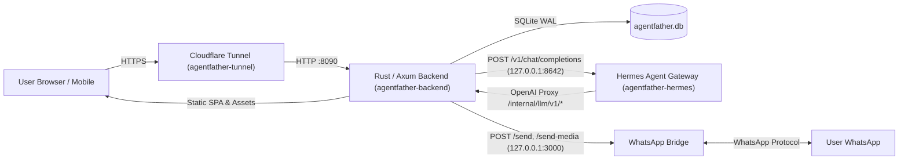
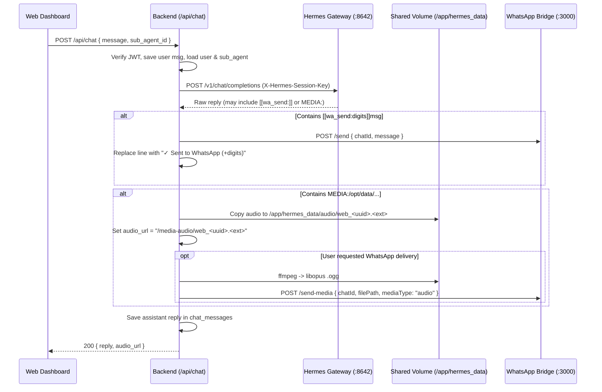

# Agent Father — System Design Document (`system_desgain.md`)

## 1. Architectural Overview

**Agent Father** uses a **single-gateway, multi-container architecture** combining:
1. **Cloudflare Tunnel (`agentfather-tunnel`)** — Exposes the web application securely over HTTPS without opening public firewall ports.
2. **Agent Runtime (`agentfather-hermes`)** — Runs `nousresearch/hermes-agent:latest` gateway (`127.0.0.1:8642`), WhatsApp bridge (`127.0.0.1:3000`), and binds host port `127.0.0.1:8090`.
3. **Core Backend & SPA Host (`agentfather-backend`)** — Rust/Axum HTTP server (`0.0.0.0:8090`) sharing the network namespace of `agentfather-hermes` (`network_mode: "service:hermes-agent"`). It serves the built React SPA, handles authentication, manages SQLite state, orchestrates Sub-Agents, executes WhatsApp & audio post-processing, and provides rotating LLM/TTS endpoints back to the agent runtime.

### Why `network_mode: "service:hermes-agent"`?
By sharing the network namespace between `agentfather-backend` and `agentfather-hermes`:
- Both containers communicate over `127.0.0.1` with zero Docker bridge DNS overhead.
- `agentfather-backend` listens on `0.0.0.0:8090`, which is published on `127.0.0.1:8090` by `hermes-agent`.
- `hermes-agent` calls `http://127.0.0.1:8090/internal/llm/v1` for LLM completions and `/internal/tts` for voice synthesis, while `agentfather-backend` calls `http://127.0.0.1:8642/v1/chat/completions` and `http://127.0.0.1:3000` (WhatsApp bridge).

---

## 2. Backend Module Architecture (`Backend/src/`)

| Module | Responsibility |
|---|---|
| [`main.rs`](file:///home/ibrahim/Desktop/AgentFather/Backend/src/main.rs) | Initializes tracing, opens SQLite `Database`, initializes `KeyPool`, constructs shared `Arc<AppState>`, registers all Axum `0.8` routes, mounts `/brand-assets`, `/media-audio`, and SPA fallback (`ServeDir` + `index.html`). |
| [`db.rs`](file:///home/ibrahim/Desktop/AgentFather/Backend/src/db.rs) | Opens SQLite with `WAL` journal mode, `synchronous = NORMAL`, `foreign_keys = ON`, and executes idempotent `CREATE TABLE IF NOT EXISTS` migrations. |
| [`auth.rs`](file:///home/ibrahim/Desktop/AgentFather/Backend/src/auth.rs) | Handles `/api/auth/signup`, `/api/auth/login`, `/api/auth/logout`, `/api/auth/me`, JWT creation/validation (`HS256`, 7-day expiry), SHA-256 salted password hashing, and Google OAuth/Gmail integration scaffolding. |
| [`chat.rs`](file:///home/ibrahim/Desktop/AgentFather/Backend/src/chat.rs) | Enforces JWT auth on `/api/chat` and `/api/chat/history`, manages Sub-Agent CRUD (`/api/sub-agents`, `/api/sub-agents/{id}`), injects user & sub-agent persona context, enforces session isolation via `X-Hermes-Session-Key`, post-processes `[[wa_send:...]]` and `MEDIA:` directives, converts audio with `ffmpeg`, and falls back to `KeyPool` Gemini if the agent gateway is unavailable. |
| [`whatsapp.rs`](file:///home/ibrahim/Desktop/AgentFather/Backend/src/whatsapp.rs) | Normalizes country code + phone numbers, generates 6-digit OTPs (10-minute TTL), sends WhatsApp text OTP + optional TTS voice note via the WhatsApp bridge, and verifies OTPs to bind `whatsapp_number` to the user record. |
| [`key_pool.rs`](file:///home/ibrahim/Desktop/AgentFather/Backend/src/key_pool.rs) | Thread-safe rotating pool (`RwLock<Vec<KeySlot>>` + `AtomicUsize`) for Gemini LLM keys and TTS synthesis, exposing `/internal/llm/v1/models`, `/internal/llm/v1/chat/completions`, `/internal/tts`, and `/internal/keys/status`. |

---

## 3. Database Schema (SQLite)

All persistent state lives in `/app/data/agentfather.db` (mounted from `./backend_data`):

### `users`
| Column | Type | Notes |
|---|---|---|
| `id` | `TEXT PRIMARY KEY` | UUID v4 |
| `name` | `TEXT NOT NULL` | Display name |
| `email` | `TEXT NOT NULL UNIQUE` | Lowercased email or username |
| `password_hash` | `TEXT` | Salted SHA-256 hex digest |
| `google_id` | `TEXT` | Optional Google OAuth subject |
| `google_access_token` | `TEXT` | Optional OAuth token |
| `google_refresh_token` | `TEXT` | Optional OAuth refresh token |
| `whatsapp_number` | `TEXT` | Verified E.164 digits (without `+`) |
| `created_at` | `TEXT NOT NULL` | RFC 3339 timestamp |

### `whatsapp_otps`
| Column | Type | Notes |
|---|---|---|
| `id` | `TEXT PRIMARY KEY` | UUID v4 |
| `user_id` | `TEXT` | Nullable user ID if initiated while logged in |
| `full_number` | `TEXT NOT NULL` | Normalized country + phone digits |
| `otp_code` | `TEXT NOT NULL` | 6-digit numeric code |
| `verified` | `INTEGER NOT NULL DEFAULT 0` | `0` pending, `1` verified |
| `expires_at` | `INTEGER NOT NULL` | Unix timestamp (`now + 600s`) |
| `created_at` | `TEXT NOT NULL` | RFC 3339 timestamp |

### `chat_messages`
| Column | Type | Notes |
|---|---|---|
| `id` | `TEXT PRIMARY KEY` | UUID v4 |
| `user_id` | `TEXT NOT NULL` | Owner user ID (strict per-user isolation) |
| `role` | `TEXT NOT NULL` | `"user"` or `"assistant"` |
| `content` | `TEXT NOT NULL` | Message body |
| `created_at` | `TEXT NOT NULL` | RFC 3339 timestamp |

### `sub_agents`
| Column | Type | Notes |
|---|---|---|
| `id` | `TEXT PRIMARY KEY` | UUID v4 |
| `user_id` | `TEXT NOT NULL` | Owner user ID (enforced on read & delete) |
| `name` | `TEXT NOT NULL` | Sub-agent display name |
| `role` | `TEXT NOT NULL` | Role / specialty badge |
| `system_prompt` | `TEXT NOT NULL` | Custom persona & behavioral instructions |
| `created_at` | `TEXT NOT NULL` | RFC 3339 timestamp |

---

## 4. Multi-User Isolation & Sub-Agent Orchestration

1. **Authentication Gate:** `/api/chat`, `/api/chat/history`, and `/api/sub-agents*` all require a valid `Authorization: Bearer <jwt>` header via `extract_claims()`. Unauthenticated calls immediately return `401 Unauthorized`.
2. **Memory Isolation:**
   - Main Agent Father sessions pass header:
     `X-Hermes-Session-Key: web-user:<user_id>`
   - Sub-Agent sessions pass header:
     `X-Hermes-Session-Key: web-subagent:<user_id>:<sub_agent_id>`
   - Ownership is verified in SQLite (`WHERE id = ?1 AND user_id = ?2`) before loading a sub-agent persona or deleting a sub-agent.
3. **System Context Injection:** Each `/api/chat` request builds a `system_context` message containing:
   - Active sub-agent persona (`name`, `role`, `system_prompt`) if `sub_agent_id` is provided.
   - User's display name and linked WhatsApp status (`+<digits>` or `NOT LINKED`).
   - Action protocols (`[[wa_send:<digits>]]<message>` and `[[audio_as_voice]]` / `MEDIA:<path>`).

---

## 5. Chat, Audio & WhatsApp Execution Pipeline

### Shared Volume Path Mapping
- Inside `agentfather-hermes`, data lives at `/opt/data/...`.
- Inside `agentfather-backend`, the same host directory (`./hermes_data`) is mounted at `/app/hermes_data/...`.
- `chat.rs` maps any `MEDIA:/opt/data/<rel>` path to `/app/hermes_data/<rel>`, copies the file into `/app/hermes_data/audio/`, and exposes it to the browser via `ServeDir::new("/app/hermes_data/audio")` at `/media-audio/<filename>`.

---

## 6. Frontend SPA Architecture (`frontend/src/App.jsx`)

- **Public Pages (No Chat Exposed):**
  - `Home`: Full-width hero banner + 3-category integration showcase (**Business** 10, **Social Media** 10, **Developers** 10 in 5×2 grids).
  - `Features`: Core capabilities overview.
  - `Pricing`: Starter, Pro, and Enterprise tiers.
  - `Status`: Operational status indicators.
- **Authenticated Dashboard (`page === 'dashboard' && user`):**
  - **Workspace Tab (`workspace`):** Sub-agent card grid, **+ New Sub-Agent** modal (`name`, `role`, `system_prompt`), delete action, and one-click **Chat with this agent** activation.
  - **Chat Tab (`chat`):** Isolated conversation stream, inline `<audio controls>` player for voice notes, active sub-agent indicator (`Agent Father → <name>`), and **Back to Agent Father** reset button.
  - **Integrations Tab (`integrations`):** Interactive WhatsApp OTP linking modal (with country codes including Egypt `+20`, Saudi `+966`, UAE `+971`, France `+33`, etc.) plus upcoming connectors.
  - **Account Tab (`account`):** User name, email/ID, linked WhatsApp number, and isolation notice.
- **Internationalization (`COPY`):** English (`en`, default) → French (`fr`) → Arabic (`ar` with `dir="rtl"`).

---

## 7. Build & Deployment Pipeline

1. **Frontend Build:** `vite build` compiles `frontend/src/` into `frontend/dist/` (`index.html` + hashed JS/CSS bundles).
2. **Backend Docker Multi-Stage Build (`Backend/Dockerfile`):**
   - **Stage 1 (`rust:1-slim-bookworm`):** Compiles `agentfather-backend` in `--release` mode.
   - **Stage 2 (`debian:bookworm-slim`):** Installs `ca-certificates` and `ffmpeg`, copies the compiled binary, `frontend/dist`, and `assets`, then runs `agentfather-backend` on port `8090`.
3. **Runtime Services (`docker-compose.yml`):** `hermes-agent`, `backend`, and `cloudflared` start together with `restart: always` / `unless-stopped`.
